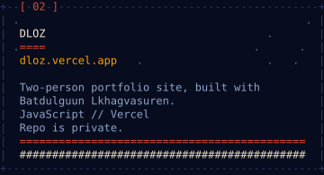

## 自己紹介 · About

I take a site from an empty repo to a working domain: data model, booking and payment flow, admin tooling, transactional email, DNS, deploy. Most of what I ship is bilingual, Mongolian and English in one codebase, because that is what clients here need. I also run a small web development agency that builds sites for clients.

## 作品 · Projects

**Semjid Khujirt** — [semjidkhujirt.com](https://semjidkhujirt.com) · [repo](https://github.com/Viuax/Semjid-v4)
Live site for a mineral-spa resort, in Mongolian and English. Three-step booking with QPay QR, bank transfer or cash. Room and treatment pages, guest accounts, an admin area, booking confirmation email, and a chatbot that answers booking questions. Next.js App Router, TypeScript, Tailwind, Supabase for Postgres and auth, Resend for email, Groq for the chatbot. Built with [@Dulguun17](https://github.com/Dulguun17).

**DLOZ** — [dloz.vercel.app](https://dloz.vercel.app)
Two-person portfolio site, built with Batdulguun Lkhagvasuren. JavaScript, deployed on Vercel. Repo is private.

**Whistl** — anti-bullying website in TypeScript. In progress, repo is private.

## 装備 · Tech stack

## 記録 · Activity

<picture>
<source media="(prefers-color-scheme: dark)" srcset="https://raw.githubusercontent.com/Viuax/viuax/output/snake-eva-dark.svg" />
<source media="(prefers-color-scheme: light)" srcset="https://raw.githubusercontent.com/Viuax/viuax/output/snake-eva-light.svg" />

</picture>

## 連絡 · Contact

- Email — [otgonbatzolboo@gmail.com](mailto:otgonbatzolboo@gmail.com)
- LinkedIn — [zolboo-otgonbat](https://www.linkedin.com/in/zolboo-otgonbat)
- Telegram — [@ViuaxZ](https://t.me/ViuaxZ)

