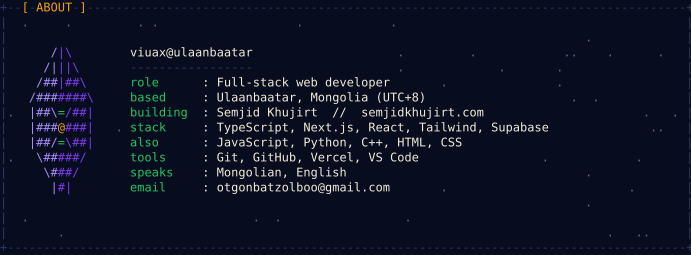
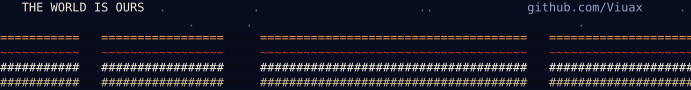

  
  
  
  

## 🛰️ Mission control

## 🌙 Moons in orbit

  
  

## 🪐 Tech in my orbit

  

## 📡 Telemetry

  

  <picture>
    <source media="(prefers-color-scheme: dark)" srcset="https://raw.githubusercontent.com/viuax/viuax/output/snake-space-dark.svg" />
    <source media="(prefers-color-scheme: light)" srcset="https://raw.githubusercontent.com/viuax/viuax/output/snake-space-light.svg" />
    
  </picture>

